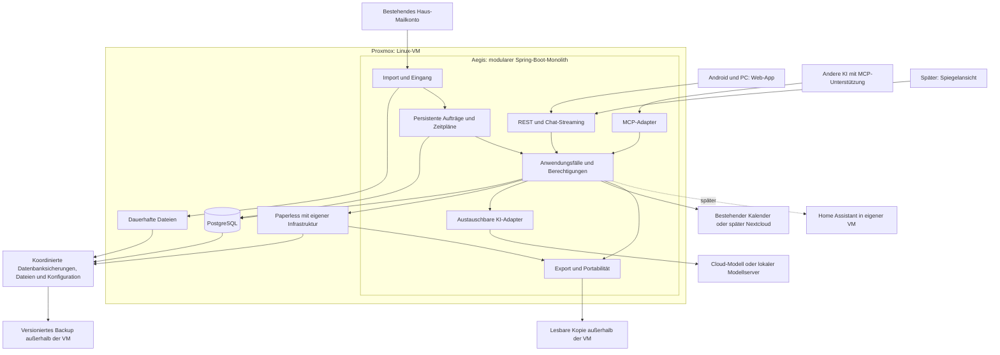

# Aegis – Roadmap zur gemeinsamen Haushaltszentrale

Stand: 13. September 2026 · Status: Architektur- und Produktplan, noch nicht implementiert

## 1. Ziel und verbindlicher Rahmen

Aegis soll einem Ehepaar helfen, Unterlagen abzulegen, verlässliche Antworten zu finden und anstehende Dinge gemeinsam zu erledigen. Langfristig kann daraus ein persönlicher Assistent mit Sprache, Eigeninitiative, Spiegelanzeige und Hausanbindung entstehen.

Der Erfolg wird zuerst am Alltag gemessen: Beide können das System ohne technische Hilfe nutzen. Die Anzahl der Automatisierungen ist kein Erfolgskriterium.

Bereits bekannt:

- Zwei Nutzer, Android-Geräte und Samsung Kalender.
- Ein separates bestehendes E-Mail-Konto für Verträge und Haus.
- Ein vorhandener Proxmox-Server.
- Java/Spring ist der vertraute Backend-Stack und wird verwendet.
- Cloud-KI ist grundsätzlich akzeptiert; Anbieter und lokale Ausführung sollen austauschbar bleiben.
- Dokumente und wesentliche Daten müssen in offenen Formaten zugänglich sein.
- Handy, PC, später MCP-Clients und Smart Mirror sollen denselben Datenbestand nutzen.

Noch offen sind Mailanbieter, die Konten hinter Samsung Kalender, Serverausstattung, Backupziel, Fernzugriff und Benachrichtigungsweg. Diese Punkte blockieren die Roadmap nicht; sie werden vor der jeweiligen Integration entschieden.

## 2. Ergebnis der unabhängigen Reviews

Drei Subagents haben Alltagstauglichkeit, Java-Architektur und Daten/Betrieb geprüft und kritische Punkte miteinander abgestimmt. Die folgende Roadmap ist die zusammengeführte Entscheidung, keine ungefilterte Sammlung von Vorschlägen.

| Ausgangsidee | Entscheidung nach Review | Begründung |
|---|---|---|
| Nextcloud gehört direkt zum Start | Erst heutige Kalenderkonten prüfen; vorhandenen Kalender über Adapter anbinden | Verhindert unnötige Migration, doppelte Termine und zusätzliche Pflege |
| App, Worker und MCP als getrennte Dienste | Ein modularer Spring-Prozess zum Start | Weniger Betrieb; fachliche Trennung ermöglicht spätere Aufteilung |
| Eigene PostgreSQL-Jobengine schreiben | Kleine persistente Scheduler-Bibliothek verwenden | Locks, Wiederaufnahme und Heartbeats nicht selbst neu entwickeln |
| Jede neue Datei startet eine große Agent-Session | Erst sicher speichern und verarbeiten; KI-Auftrag anschließend bedarfsgerecht | Eingang bleibt auch ohne KI funktionsfähig |
| MD-Datei als Hauptgedächtnis | Markdown für Vorlieben; strukturierte Fakten und Zustände in PostgreSQL | Quellen, Gültigkeit, Benutzerrechte und Konflikte bleiben beherrschbar |
| CSV bedeutet vollständige Unabhängigkeit | Lesbarkeit, Migration und Weiterbetrieb getrennt zusagen | Eine CSV ist keine gleichwertige Aufgaben-App |
| Intelligente Tagesplanung zuerst | Zuerst regelbasierte Heute-Ansicht und klare Zuständigkeiten | Eine KI darf Fälligkeiten nicht erfinden oder verschwinden lassen |
| Alle Integrationen auf einmal | Ein vollständiger kleiner Ablauf, danach zwei Wochen Pilot | Nutzung durch beide entscheidet über Ausbau |

Bewusst akzeptierter Kompromiss: Eigene Aufgabenverwaltung mit offenen Exporten. Bei App-Ausfall sind Aufgaben lesbar und migrierbar, aber nicht komfortabel gemeinsam weiterbearbeitbar. Falls unabhängige aktive Aufgabenbearbeitung zur harten Anforderung wird, muss vor Phase 3 ein etabliertes Aufgabensystem als führende Quelle gewählt werden.

## 3. Zielarchitektur



### Stackentscheidung

| Bereich | Entscheidung |
|---|---|
| Backend | Java LTS und kompatible stabile Spring-Boot-Version; exakte Versionen in Phase 0 festlegen |
| API | Spring MVC, REST; SSE für sichtbaren Chatfortschritt |
| Sicherheit | Spring Security, zwei Benutzer, serverseitige Rechteprüfung |
| Persistenz | PostgreSQL, Spring Data JPA, Flyway |
| Jobs | db-scheduler in PostgreSQL; fachliche Operationen separat gespeichert |
| KI | Spring AI hinter eigenen schmalen Interfaces |
| MCP | Spring AI MCP Server, Streamable HTTP; anfangs nur lesende Werkzeuge |
| Oberfläche | React, TypeScript, Vite, Tailwind, shadcn/ui; installierbare PWA |
| API-Vertrag | OpenAPI und generierter TypeScript-Client; keine handgepflegten doppelten DTOs |
| Dokumente | Paperless-ngx über seine API; eigene benötigte Redis-/Konverter-Dienste |
| Kalender | CalendarPort; konkrete Integration erst nach Kontenprüfung |
| Betrieb | Debian-VM, Docker Compose, feste Versionen, Caddy für HTTPS |
| Sicherung | Restic für konsistente Backup-Artefakte und Dateien; getrennte lesbare Exporte |
| Verifikation | JUnit, Spring-Integrationstests mit PostgreSQL/Testcontainers, wenige Playwright-Abläufe und echte Android-Tests |

Spring Modulith kann Modulgrenzen prüfen; ein zweites persistentes Ereignissystem wird nicht ohne konkreten Bedarf zusätzlich eingeführt. Kafka, Kubernetes, eine separate Vektordatenbank und Microservices gehören nicht zum Startumfang.

### Fachliche Module

```text
identity       Benutzer, Haushaltsmitgliedschaft, Zugriffsrechte
inbox          Uploads, Mailkonten, Empfangsbestätigungen, Importstatus
documents      Paperless-Adapter, Dokumentreferenzen, Suche
contracts      Vertragsidentitäten, Fakten, Quellen, zeitliche Änderungen
planning       Aufgaben, bestätigte Fristen, Heute-Ansicht, Kalenderadapter
assistant      Gespräche, Modelladapter, Agent-Läufe, Werkzeugausführung
automation     Ereignisse, Zeitpläne, Operationsstatus, Ausführungslimits
portability    Exporte, Prüfsummen, Import, Wiederherstellungsunterstützung
integrations   Benachrichtigungen, später Haussteuerung und weitere Dienste
```

REST, MCP, Hintergrundaufträge und interne Agenten verwenden dieselben Anwendungsfälle. Ein REST-Aufruf wird nicht intern durch MCP umgeleitet. MCP ist ein zusätzlicher Zugang, keine zusätzliche Geschäftslogik.

## 4. Datenhoheit und Portabilität

| Datenart | Führendes System | Offenes Format / unabhängiger Zugriff |
|---|---|---|
| Originaldokument und Archivfassung | Paperless-Dateiablage | Originalformat, PDF/A soweit erzeugt, Paperless-Export |
| Original-E-Mail | Anbieterpostfach und lokale unveränderte Kopie | EML; Anhangsbeziehungen in Manifest |
| Dokumenttitel, Klassifikation | Paperless | Exportmetadaten; Aegis hält Referenz und nötigen Such-/Verarbeitungsstand |
| Vertrag, bestätigter Beitrag, relevante Frist | Aegis-PostgreSQL | JSON mit Schema-Version, zusätzlich CSV/Markdown |
| Aufgaben, Verantwortlichkeit, Erledigung | Aegis-PostgreSQL | JSON für Migration; CSV/Markdown zum Lesen |
| Termine | Gewählter Kalenderanbieter | ICS; Aegis hält externe ID und Synchronisationsstand |
| Haushaltsvorlieben | Versionierte Markdown-Dateien | Markdown, ohne Zugangsdaten |
| Ausführbare Planungsregeln | Aegis-PostgreSQL | JSON; Beschreibung kann in Markdown vorliegen |
| Chat und ausgeführte Aktionen | Aegis-PostgreSQL | Markdown/JSON; relevante Entscheidungen werden explizit als Fakten übernommen |
| Suchindex, Embeddings, Zusammenfassungen | Abgeleitet, wiederaufbaubar | Nicht die einzige Kopie einer Information |

### Mindestmodell

- DocumentRef: interne ID, Paperless-ID, Dateiprüfsumme, Herkunft, Berechtigung, Importstatus.
- SourceRef: Dokument-/Mail-ID, Seite oder Textstelle, optional Auszug. Wenn die Seite nicht zuverlässig verfügbar ist, wird keine Seitenzahl erfunden.
- Contract und Fact: Feld, Wert, Einheit, gültig-ab/bis soweit bekannt, Quelle, Prüfstatus, vorheriger Stand.
- Task: Titel, zuständige Person oder unzugeordnet, Status, echte Fälligkeit, separat geplanter Bearbeitungstag, Quelle, Versionsnummer.
- CalendarLink: Anbieter, Kalender-ID, Ereignis-ID, Version/ETag soweit unterstützt, letzter erfolgreicher Abgleich.
- Operation: Typ, Idempotenzschlüssel, Referenzen, Status, Versuche, Fehlerkategorie, Erstell-/Abschlusszeit, Ausführungsbudget.
- Delivery: Benachrichtigung, Empfänger, zugrunde liegende Aufgaben-/Terminversion, Versandversuche und letzter bestätigter Zustellstand. „Gespeichert“, „versendet“, „zugestellt“ und „gelesen“ werden nur soweit tatsächlich nachweisbar unterschieden.
- Proposal: vorgeschlagene Änderung, betroffene Version, Quelle, Prüfstatus und Freigabeentscheidung.
- ExportManifest: Schema-Version, Erstellzeit, enthaltene IDs, relative Dateipfade, Prüfsummen, Vollständigkeitsstatus.

Fakten unterscheiden „extrahiert“, „bestätigt“, „verworfen“ und „ersetzt“. Bestätigte Werte werden durch eine spätere KI-Auswertung nicht still überschrieben. Ein Vertragsnachtrag kann einen neuen zeitlichen Stand erzeugen.

Externe Paperless-IDs können sich bei Migration ändern. Ein Wiederimport ordnet Dokumente anhand stabiler Aegis-IDs und Prüfsummen neu zu, statt alte Paperless-IDs ungeprüft zu übernehmen. Fehlende Originale werden ausdrücklich gemeldet; Quellenbeziehungen dürfen nicht unbemerkt ins Leere zeigen.

### Drei verschiedene Zusagen

1. **Lesbar:** PDF, EML, Markdown und CSV lassen sich ohne Aegis öffnen.
2. **Migrierbar:** Versionierte JSON-/ICS-Exporte erhalten Beziehungen und können getestet in eine frische Installation oder geeignete Fremdsoftware übernommen werden. Nicht jede Fremdsoftware unterstützt alle Zusatzfelder.
3. **Weiter betreibbar:** Paperless und Kalender bleiben direkt bedienbar, solange diese Dienste laufen. Eigene Aufgaben und Chat benötigen Aegis für ihre volle Funktion.

Exporte sind zunächst einseitige Ausgaben. Manuelles Bearbeiten einer exportierten CSV ändert nicht die Arbeitsdaten. Eine spätere Importfunktion läuft ausdrücklich mit Vorschau und Konfliktprüfung.

### Vorgesehene Ablage in der VM

```text
/srv/aegis/
  deploy/                   Compose-Dateien und Betriebskonfiguration
  data/
    postgres/               Dauerhafte Datenbankdaten, nicht manuell bearbeiten
    paperless/              Originale, Archivdateien und Paperless-Daten
    ingress/                Sicher angenommene, noch nicht archivierte Uploads
    emails/                 Unveränderte EML-Dateien
    knowledge/              Haushaltswissen als Markdown
  exports/
    generations/            Vollständige, atomar veröffentlichte Exportstände
    latest/                 Letzter erfolgreich erzeugter Stand
  backup-staging/           Konsistente Dumps und Manifeste für Sicherungen
```

Dateinamen der lesbaren Exporte enthalten Datum, Titel und ID. Relative Quellenlinks funktionieren innerhalb des Exports. Nicht bestätigte KI-Vorschläge werden als solche gekennzeichnet. Ein Export ist vollständig oder sichtbar fehlgeschlagen; ein halb geschriebener Stand ersetzt keinen guten Stand.

## 5. Zuverlässige Abläufe

### Upload

1. Datei entgegennehmen und dauerhaft in ingress speichern.
2. Prüfsumme und Empfangsdatensatz erfassen; erst danach „sicher gespeichert“ bestätigen.
3. Verarbeitung dauerhaft einplanen. Dateisystem und Datenbank sind keine gemeinsame Transaktion: ein Abgleich findet liegengebliebene Dateien bzw. unvollständige Datensätze.
4. An Paperless übergeben und tatsächlichen Importabschluss prüfen.
5. Referenz speichern und anschließend Extraktion einplanen.
6. „Verarbeitet“ erst bei erfolgreichem Ergebnis anzeigen. Staging-Kopie erst nach verifizierter Archivierung und definierter Aufbewahrungsregel entfernen.

Zustände für Nutzer: „Wird hochgeladen“, „Sicher gespeichert“, „Wird verarbeitet“, „Bereit“, „Bitte prüfen“, „Fehler – erneuter Versuch“. Offline oder bei Abbruch darf keine falsche Speicherbestätigung erscheinen.

### E-Mail

Zielentscheidung: Ein Aegis-Importadapter besitzt die Pipeline für das Hauskonto. Er sichert EML, behandelt Anhänge und Nachrichtentext und übergibt relevante Dokumente an Paperless. Die native Paperless-Mailabholung wird für dieses Konto nicht parallel aktiviert. Dieser Mehraufwand ist durch die gewünschte Verarbeitung ganzer Mails einschließlich Aufgaben ohne PDF begründet.

- Einmalige Verbindung über anbietergeeignetes OAuth oder IMAP/App-Passwort. Anbieterspezifische Registrierung und erneute Anmeldung können nötig sein.
- Zugangsdaten bleiben serverseitig geschützt und gelangen weder in Prompts noch in lesbare Exporte.
- Erst einen kleinen Zeitraum importieren; Altbestand danach begrenzt nacharbeiten.
- Historischer Import ist ein eigener Modus „Archiv aufbauen“: keine ungeprüften aktuellen Aufgaben aus alten Fristen und keine Benachrichtigungsflut. Relevante Vorschläge werden gebündelt zur Prüfung angeboten.
- Abrufzustand mit Konto, Ordner, UIDVALIDITY/UID soweit IMAP und zusätzlicher Inhaltsprüfung speichern. Message-ID allein reicht nicht als zuverlässige Dublettenerkennung.
- Fortschritt erst nach dauerhafter Sicherung speichern. Wiederholungen müssen sicher sein.
- Originalmail behalten; keine automatische Löschung beim Anbieter. Ein verarbeiteter Brief ist nicht automatisch eine erledigte Aufgabe.
- Derselbe Anhang kann zu mehreren Mails gehören: Dokument einmal archivieren, mehrere Herkunftsbezüge erhalten. Ähnlicher Inhalt mit anderer Dateiprüfsumme wird als mögliche Dublette angezeigt und nicht blind verworfen. Signaturgrafiken werden nicht zu Aufgaben.
- Textmails, mehrere Anhänge, Weiterleitungen, verschlüsselte PDFs, ungültige Anhänge, abgelaufene Tokens und verschobene Nachrichten sichtbar behandeln.
- Portal-Links erzeugen bei fehlender Integration eine konkrete Aufgabe; die dahinterliegende Rechnung gilt noch nicht als archiviert.

### Hintergrundaufträge

db-scheduler übernimmt persistente Zeitplanung und Ausführungskoordination. Die fachliche Operation-Tabelle hält sichtbaren Status, Idempotenz und Audit. Der Spike in Phase 1 muss die atomare Verbindung zwischen fachlicher Änderung und Jobanlage nachweisen. Falls keine gemeinsame Transaktion nutzbar ist, wird ein kleines transaktionales Outbox-Muster verwendet.

Jobpayloads enthalten stabile IDs und eine Schema-Version statt serialisierter vollständiger Java-Objektgraphen. Alte Aufträge müssen nach einem Anwendungsupdate lesbar bleiben oder ausdrücklich migriert werden.

Es gilt mindestens einmalige Ausführung, keine pauschale Exactly-once-Zusage. Externe Änderungen erhalten stabile Aktionskennungen. Nach einem Timeout wird zuerst der externe Zustand abgeglichen, bevor erneut geschrieben wird. Wiederholungen verwenden begrenztes Backoff; dauerhaft fehlerhafte Arbeit bleibt sichtbar und kann manuell neu gestartet werden.

### Tagesplanung und Benachrichtigungen

- Ein deterministischer Kern liest bestätigte Termine, überfällige Aufgaben, Fälligkeiten und Vorlaufregeln.
- Zeitzone Europe/Berlin explizit; reine Daten, Ganztagstermine und Zeitpunkte getrennt modellieren.
- Sommerzeitwechsel, Wiederholungen, Terminänderungen und abgesagte Termine berücksichtigen.
- Eine KI darf formulieren, priorisieren vorschlagen und Zusammenhänge erklären; sie ist nicht die maßgebliche Fälligkeitsberechnung.
- „Heute nicht“ verschiebt den Bearbeitungsvorschlag, nicht die echte Frist.
- Unzugeordnete Aufgaben sind sichtbar. Eine Aufgabe hat zunächst genau eine zuständige Person oder ist ausdrücklich unzugeordnet.
- Tagesübersicht zu vereinbarter Uhrzeit; tagsüber nur relevante neue oder geänderte Hinweise. Gleiche Hinweise werden nicht bei jedem Lauf erneut gesendet.
- Verpasste Tagesläufe werden nach einem Neustart sinnvoll einmal nachgeholt. Veraltete Erinnerungen werden anhand der aktuellen Aufgaben-/Terminversion verworfen; kein Nachversand einer Reihe überholter Morgenübersichten.
- Bereits bestätigte Kalendererinnerungen sind der anfängliche verlässliche Handyweg. PWA-Push wird erst nach Tests mit Samsung-Energiesparverhalten versprochen.
- Diese Kalendererinnerungen betreffen bei nur lesender Integration bestehende Termine. Neue Aufgaben und der Tagesüberblick benötigen einen eigenen getesteten Zustellweg. Bis dieser verfügbar ist, ist die Heute-Ansicht ausdrücklich zum Öffnen in der App vorgesehen und kein zugesagter Push-Dienst.
- Veraltete Kalenderdaten werden mit letztem Synchronisationszeitpunkt angezeigt; keine Aussage „heute nichts“ bei gescheitertem Abruf.
- Versand und Zustellung haben einen eigenen Status. Eine gespeicherte Aufgabe beweist nicht, dass eine Erinnerung auf dem Handy angekommen ist. Der Pilot prüft auch absichtlich fehlgeschlagene Zustellung.

### Chat und KI

- Einfache Extraktion als begrenzter Modellaufruf mit validiertem Ergebnis; mehrstufige Recherche als begrenzter Agent-Lauf.
- Eigene Interfaces für Extraktion und Recherche halten Fachlogik unabhängig von Spring-AI- oder Herstellerobjekten.
- Ein optionaler Claude-Agent-SDK-Dienst ist erst bei belegtem Mehrwert vorgesehen.
- Text, Werkzeugstatus, Quellen und Ergebnis werden gestreamt; kein Anspruch auf Offenlegung interner Modellgedanken.
- Operation und sichtbare Ergebnisse bleiben bei Verbindungsabbruch erhalten. Wiederverbindung lädt den aktuellen Stand, statt die Aktion blind neu auszuführen.
- Anbieterwechsel bewahrt Daten und Aufträge. Werkzeugtreue und Antwortqualität müssen separat getestet werden.
- Dokumentinhalte gelten als Daten; darin enthaltene Anweisungen dürfen keine Rechte erweitern.
- Zugriffsschutz wird vor Suche und erneut vor Dokument-/Werkzeugzugriff geprüft, einschließlich Cache und Export.
- Direkter Paperless-Zugang muss dieselben gemeinsamen/persönlichen Grenzen abbilden. Persönliche Dokumente dürfen nicht durch allgemeine Paperless-Konten, breite Service-Tokens oder gemeinsame Exportordner sichtbar werden. Administrativer Zugriff des Serverbetreibers ist gesondert von normalen Benutzerrechten zu betrachten.

## 6. Roadmap mit überprüfbaren Freigabepunkten

Die Phasen sind abhängigkeitsbasiert. Sie sind keine feste Termin- oder Aufwandszusage. Jede Phase endet mit einer demonstrierbaren Funktion; Erweiterungen beginnen erst nach bestandenem Freigabepunkt. Für Kalender- und Mailanbieter bleibt bewusst ein technischer Spike vorgesehen.

### Phase 0 – Bestand und Entscheidungen

**Ziel:** Vermeiden, dass die Lösung an euren tatsächlichen Geräten und Gewohnheiten vorbeigeht.

Arbeitspakete:

- Mailanbieter, Anmeldung und Umfang des Hauspostfachs feststellen.
- Auf beiden Handys Kalenderkonten und gemeinsam verwendete Kalender feststellen; lokale Gerätekalender identifizieren.
- Proxmox-Ressourcen, dauerhaften Speicher, zweites Backupziel und Fernzugriff prüfen.
- Mit beiden Nutzern zehn typische Alltagssituationen auswählen.
- Einen kleinen repräsentativen Satz von etwa 20–30 Unterlagen zusammenstellen: Scan, Rechnung, Vertrag, Nachtrag, reine Textmail, Portalhinweis und schwieriger Scan.
- Gemeinsame versus persönliche Bereiche und anfängliche Benachrichtigungsregeln festlegen.
- Kompatible stabile Java-/Spring-/Spring-AI-Versionen und Lizenz-/Authentifizierungsbedingungen der konkret gewählten Dienste prüfen und festschreiben.

**Ergebnis:** Kurze Entscheidungsnotizen, Referenzunterlagen und zehn priorisierte Szenarien.

**Abnahme:** Beide erkennen ihren Alltag in den Szenarien wieder. Mail- und Kalenderintegration haben einen konkreten technischen Weg. Kein Nextcloud-Zwang ohne begründete Entscheidung.

### Phase 1 – Betrieb, Datenfundament und Wiederherstellung

**Ziel:** Daten sind dauerhaft gespeichert und eine Wiederherstellung ist vor echtem Vertrauen erprobt.

Arbeitspakete:

- Spring-Projekt, React-Grundgerüst, PostgreSQL und Flyway einrichten.
- Modulgrenzen, Spring Security und zwei Benutzer anlegen; offene Selbstregistrierung ist nicht erforderlich.
- Compose, HTTPS/Fernzugriff, persistente Volumes und Paperless installieren.
- Job-Spike: Neustart während Verarbeitung, erneute Zustellung, transaktionale Jobanlage und Fehlerstatus prüfen.
- Backup- und Exportbasis mit Statusanzeige aufbauen; Zugang zur Wiederherstellung separat dokumentieren.
- Healthchecks, Speicherüberwachung und kurze strukturierte Fehlerprotokolle einrichten. Dokumentinhalte und Tokens nicht in Standardlogs schreiben.

**Abnahme:** Container neu erstellen erhält Daten. Beide Benutzer können sich anmelden. Rechteverletzung wird serverseitig abgewehrt. Ein persönliches Dokument bleibt auch beim direkten Paperless-Zugriff für den anderen normalen Benutzer verborgen; alternativ wird direkter Zugriff zunächst auf gemeinsamen Bestand beschränkt. Ein Testauftrag überlebt Prozessabbruch. Eine frische Testinstallation lässt sich aus Sicherung herstellen und öffnet ein geprüftes Original.

### Phase 2 – Ablegen und Wiederfinden ohne KI-Abhängigkeit

**Ziel:** Beide können Dokumente einfach ablegen und wiederfinden.

Arbeitspakete:

- Mobiler Datei-Upload, Scan-PDF-Upload und Drag-and-drop am PC.
- Deutlicher Empfangs- und Verarbeitungsstatus, Wiederholungen ohne doppelte Dokumente.
- Paperless-Anbindung, Dokumentvorschau und Volltext-/Metadatensuche.
- Minimaler Eingang ohne Pflichtsortierung; nur problematische Eingänge brauchen Aufmerksamkeit.
- Lesbarer Dokumentexport mit Manifest, Prüfsummen und relativen Links; Kopie außerhalb der VM.
- Android-Teilen-Integration als Geräte-Spike. Bei unzuverlässigem Verhalten bleibt ein gut erreichbarer Uploadweg; native Hülle nur bei belegtem Bedarf.

**Abnahme:** Beide laden selbstständig einen Scan und eine vorhandene PDF hoch. Ein absichtlich unterbrochener Upload erzeugt keine falsche Erfolgsmeldung. Wiederholung erzeugt kein doppeltes Dokument. Eine Stichprobe aus dem Export lässt sich bei gestopptem Aegis und Paperless auf einem anderen Gerät öffnen.

### Phase 3 – Aufgaben und gemeinsame Heute-Ansicht

**Ziel:** Das System hilft beim Erledigen, bevor es intelligent formuliert.

Arbeitspakete:

- Aufgaben anlegen, zuweisen, erledigen und auf einen anderen Bearbeitungstag legen.
- Quelle am Dokument verknüpfen; tatsächliche Frist separat speichern.
- CalendarPort für den in Phase 0 gewählten Anbieter zunächst lesend anbinden.
- Heute-Ansicht mit Terminen, offenen Aufgaben, unzugeordneten Aufgaben und ungeklärten Eingängen.
- Benachrichtigungspräferenzen, täglicher Überblick und Regeln gegen doppelte Hinweise. Einen konkreten Zustellweg am echten Handy testen; bis dahin bleibt der Überblick eine abrufbare App-Ansicht. Fehlende Zustellung ist sichtbar und blockiert das Versprechen automatischer Aufgaben-Erinnerungen.
- Aufgabenexport als JSON, CSV und Markdown; Testimport des JSON in eine leere Testinstallation.

**Abnahme:** Eine Erledigung ist auf dem anderen Gerät sichtbar. Gleichzeitige Änderungen überschreiben sich nicht still. „Heute nicht“ ändert keine Frist. Fehlgeschlagener Kalenderabruf wird angezeigt. Aufgaben inklusive Quelle, Zuständigkeit und Status überstehen Export/Import. Der Quellenlink öffnet nach Wiederimport das richtige Dokument auch bei geänderter Paperless-ID. Automatische Aufgaben-Erinnerungen gelten erst nach erfolgreichem Zustelltest auf beiden Handys als fertig.

### Phase 4 – Hauspostfach und KI-Vorschläge

**Ziel:** Neue Unterlagen und Textmails erzeugen nachvollziehbaren Handlungsbedarf.

Arbeitspakete:

- Einen Mailanbieter anbinden, zuerst Testzeitraum, dann neue Nachrichten.
- EML-Sicherung, Anhänge, Textinhalt und Importfortschritt implementieren.
- Ein Cloud-Modell hinter dem Extraktionsinterface integrieren.
- Dokumentart, Vertragspartner, Beträge, Termin-/Fristkandidaten und Handlungsbedarf mit Quellen extrahieren.
- Vorschläge in verständlicher Form bestätigen, korrigieren oder verwerfen.
- Bestätigte Kalenderänderungen über CalendarPort mit externer ID und Wiederholschutz ausführen.
- Kosten-/Zeit-/Versuchsgrenzen je Operation setzen.

**Abnahme:** Doppelte Abrufe erzeugen keine doppelten Aufgaben. Eine Textmail ohne PDF wird berücksichtigt. Ein Portalhinweis wird nicht als archivierte Rechnung dargestellt. Ungültiger Token und verschlüsselte PDF sind sichtbar. KI-Ausfall blockiert die Ablage nicht. Keine unbestätigte wichtige Frist wird als gesicherte Tatsache dargestellt.

### Phase 5 – Zwei Wochen Alltagspilot

**Ziel:** Beweisen, dass beide das System nutzen können und es gemeinsame Arbeit reduziert.

Umfang: Neue Post und die wichtigsten bestehenden Unterlagen, keine vollständige Altbestandsmigration. In dieser Phase keine neuen Großfunktionen hinzufügen.

Vorläufige, gemeinsam zu überprüfende Messziele:

| Messung | Pilotziel |
|---|---|
| Vorhandene Datei ablegen | In mindestens 8 von 10 Versuchen innerhalb von 30 Sekunden bis bestätigter Speicherung; Netzzeit getrennt betrachten |
| Bekanntes Dokument finden | In mindestens 8 von 10 Aufgaben innerhalb einer Minute |
| Nutzung durch beide | Jeder erledigt die Kernabläufe selbst, ohne Serverwissen oder Hilfe des Entwicklers |
| Verlorene bestätigte Uploads | Null in den geprüften Fällen |
| Doppelte Aufgaben/Termine durch Wiederholung | Null in den geprüften Fällen |
| Falsche Behauptung „erledigt/gespeichert“ | Null in den geprüften Fällen |
| Gemeinsame Eingangspflege | Zielwert höchstens etwa zehn Minuten pro Woche; Menge dokumentieren |
| Benachrichtigungen | Jeder Hinweis führt zu einer sinnvollen Handlung oder wird als unnötig erfasst |

Die Stichproben sind ein Freigabekriterium, kein statistischer Nachweis absoluter Zuverlässigkeit. Probleme werden in „verwirrend“, „zu viele Schritte“, „fehlende Information“ und „technischer Fehler“ eingeordnet.

**Abnahme:** Beide möchten das System weiter benutzen. Offene Zuverlässigkeits- und Bedienprobleme sind behoben. Wenn der Pilot scheitert, wird der Eingang vereinfacht, bevor Chat, Sprache oder Spiegel hinzukommen.

### Phase 6 – Quellenbasierter Assistent und MCP

**Ziel:** Natürliche Fragen liefern belegte Antworten auf denselben Datenbestand.

Arbeitspakete:

- Chat mit Streaming, Quellenlinks und Wiederaufnahme nach Verbindungsabbruch.
- Werkzeuge für Dokumentensuche, Dokumentlesen, Vertragsstand und anstehende Aufgaben.
- MCP zunächst mit lesenden Werkzeugen und expliziter Authentifizierung bereitstellen.
- Kleine feste Sammlung realer Fragen samt erwarteten Quellen anlegen.
- Widersprüche und fehlende Unterlagen sichtbar machen; Nachträge und aktuelle Rechnungen berücksichtigen.
- Zweiten Modelladapter am selben Fragensatz testen. Lokale Ausführung ist optional und hardwareabhängig.

**Abnahme:** Antworten verweisen auf vorhandene Quellen. Fehlende Informationen führen zu einer transparenten Lücke. Rechte gelten auch über MCP. Ein Anbieterwechsel verändert keine Arbeitsdaten. „Früherer Vertrag vs. neue Rechnung“ wird in den Referenzfällen korrekt unterschieden.

### Phase 7 – Eigeninitiative und begrenzte Aktionen

**Ziel:** Der Assistent erkennt Veränderungen und bereitet sinnvolle nächste Schritte vor.

Arbeitspakete:

- Preisänderungen, nahende bestätigte Fristen und erforderliche Vorbereitungen erkennen.
- Freigegebene wiederkehrende Abläufe und Planungsregeln konfigurieren.
- Vorschau von Änderungen, dauerhafte Freigaben für klar begrenzte Aktionen und Auditprotokoll.
- MCP-Schreibwerkzeuge nur mit derselben serverseitigen Rechte-/Freigabeschicht ergänzen.
- Eine Freigabe bindet sich an die konkret geprüfte Aktion und Datenversion; geänderte Daten machen sie ungültig.

**Abnahme:** Keine extern versandte Nachricht, Ausgabe oder Vertragsaktion ohne passende Autorisierung. Wiederholte Ausführung erzeugt keine doppelte externe Änderung. Veraltete Vorschläge werden neu geprüft. Benachrichtigungen werden zusammengefasst und priorisiert.

### Phase 8 – Spiegel und Sprache

**Ziel:** Den vorhandenen Assistenten an weiteren Orten bequem erreichen.

Arbeitspakete:

- Lesender Spiegelmodus derselben Web-App; letzte Aktualisierung und Offlinezustand sichtbar.
- Gerätekennung mit begrenzten Rechten; nur freigegebene Haushaltsinformationen anzeigen.
- Sprache zunächst über Sprechtaste am Handy oder Spiegel; austauschbare STT-/TTS-Adapter.
- Persönliche oder folgenreiche Aktionen über angemeldetes Handy bestätigen.
- Wakeword und Raum-Mikrofone erst nach Sprachpilot, wenn tatsächlicher Nutzen erkennbar ist.

**Abnahme:** Spiegel funktioniert ohne dauernden KI-Aufruf. Falsch verstandene Sprache lässt sich korrigieren. Ein Raumgerät erhält keine pauschalen persönlichen Rechte. Ausfall der Sprachfunktion beeinflusst Upload und Planung nicht.

### Phase 9 – Hausanbindung und weitergehender Jarvis

**Ziel:** Kontext aus Haus und Planung verbinden, ohne die Basisfunktionen abhängig zu machen.

Arbeitspakete:

- Home Assistant in eigener VM betreiben und zunächst nur ausgewählte Zustände lesen.
- Eine kleine Liste freigegebener Aktionen definieren, beispielsweise Lichtszene oder Abwesenheitsmodus.
- Ereignisse entprellen, doppelte Hinweise vermeiden und Fähigkeiten je Gerät begrenzen.
- Sicherheitsrelevante Aktionen individuell behandeln; Sprachidentifikation allein genügt dafür nicht.

**Abnahme:** Hausautomation bleibt ohne KI funktionsfähig. Ausfall oder Neustart von Home Assistant beeinträchtigt das Dokumentenarchiv nicht. Jede KI-Aktion ist nachvollziehbar und auf freigegebene Fähigkeiten begrenzt.

## 7. Betrieb, Ausfälle und Wiederherstellung

### Minimaler Startbetrieb

Eine Linux-VM mit einem Aegis-Prozess, PostgreSQL, Paperless und dessen benötigten Diensten sowie Caddy. Separate Datenbanken und Benutzer pro Anwendung; kompatible gemeinsame PostgreSQL-Instanz ist möglich. Ein Startwert von ungefähr 4 vCPU und 8–12 GB RAM ohne lokales Sprachmodell ist eine Planungshypothese und wird gemessen, keine Hardwaregarantie.

Nextcloud kommt nur dazu, wenn Kalenderentscheidung oder weitere tatsächliche Anforderungen es rechtfertigen. Beim späteren lokalen Modell sind Speicher, RAM/VRAM, Modellgröße und Antwortzeit separat zu messen.

### Sicherungsziele

- Vorläufiges Backupziel: höchstens 24 Stunden Datenverlust beim vollständigen Serververlust (RPO), anhand täglicher Sicherung. Häufigere Sicherung kann nötig sein, wenn euch das nicht genügt.
- Wiederherstellungsziel: innerhalb eines Tages nach verfügbarer Ersatzhardware bzw. wiederhergestelltem Speicher; im Restore-Test messen, nicht voraussetzen.
- Export zeitnah nach Änderungen, mindestens täglich mit sichtbarem letzten Erfolgszeitpunkt. Nur tatsächlich extern kopierte Stände schützen bei Serverausfall.
- Zweites lokales Gerät und verschlüsseltes Offsite-Backup. Aufbewahrung mit mehreren Generationen; eine Löschung darf nicht sofort alle Sicherungsstände entfernen.
- Laufende PostgreSQL-Datenverzeichnisse nicht einfach als konsistentes Backup kopieren. Datenbankgerechte Sicherung, Paperless-Export und passend koordinierte Datei-/Konfigurationssicherung verwenden.
- Wiederherstellungsanleitung, Schlüsselzugang und Notfallzugriff dürfen nicht ausschließlich in Aegis liegen.

### Sichtbarer Betriebszustand

Eine kleine Statusseite zeigt letzten Mailabruf, letzten Kalenderabgleich, fehlgeschlagene Aufträge, letzten Export, letztes externes Backup und freien Speicher. Hinweise gehen nur bei relevantem Fehler an den zuständigen Betreiber. Ein stiller Ausfall ist kein akzeptierter Normalzustand.

Geplante Pflege: kurze regelmäßige Sichtprüfung, gebündelte Updates mit Backup und Prüfung der Kernabläufe, Restore-Test nach größeren Daten-/Backupänderungen sowie regelmäßig im Betrieb. Exakte Intervalle in Phase 1 festlegen.

## 8. Wann zusätzliche Infrastruktur gerechtfertigt ist

| Erweiterung | Konkreter Auslöser |
|---|---|
| Separater Worker-Prozess | Hintergrundarbeit beeinträchtigt messbar UI/Antwortzeit oder braucht unabhängige Ressourcenlimits |
| Separater Claude-Agent-Dienst | Ein benötigter Arbeitsablauf ist mit diesem SDK wesentlich besser umsetzbar und im Pilot nachgewiesen |
| pgvector | Reale Suchfragen scheitern trotz guter Volltextsuche und Metadaten |
| Eigener Modellserver | Datenschutzpräferenz, Offlinebedarf oder gemessene Kosten rechtfertigen Hardware und Pflege |
| Native Android-Hülle | Teilen/Upload/PWA-Benachrichtigungen bleiben auf euren Geräten nachweislich unzureichend |
| Nextcloud | Bestehender Kalender erfüllt gemeinsame Nutzung/Integration nicht oder Selbsthosting wird bewusst gewählt |
| Mehrere VMs/Dienste | Eigenständiger Hardwarebedarf oder klarer Ausfallbereich, beispielsweise Home Assistant oder GPU-Modell |

## 9. Wichtigste Risiken und Gegenmaßnahmen

| Risiko | Gegenmaßnahme und Prüfung |
|---|---|
| Nur der Entwickler nutzt das System | Beide bedienen Kernabläufe im Pilot ohne Hilfe |
| Eingang verlangt zu viel Pflege | Keine Pflichtsortierung, Ausnahmen bündeln, tatsächliche Pflegezeit messen |
| KI erfindet Fristen oder Vertragsstände | Quelle, Prüfstatus, zeitliche Fakten und bestätigte Änderungen |
| Doppelte externe Aktionen | Idempotenz, externe IDs und Zustandsabgleich nach unklarem Timeout |
| App-Ausfall wird mit Datenverlust verwechselt | Lesbarer Export plus separate Wiederherstellung; Fähigkeiten ehrlich ausweisen |
| Spiegel oder MCP umgehen Berechtigungen | Gemeinsame serverseitige Anwendungsfälle und gerätespezifische Rechte |
| Synchronisation verteilt Fehler | Führendes System je Datenart, Versionsprüfung, keine unkontrollierte bidirektionale Kopie |
| Wachsende Kosten durch Agent-Schleifen | Zeit-, Aufruf- und Kostenbudgets; sichtbare Abbrüche, kein stiller Anbieter-Fallback |
| Vollständige Mailablage erzeugt zu viel Lärm | Import und Aufgabenbildung trennen; große Anhänge/Altbestand begrenzen |
| Funktionsausbau überholt Stabilität | Phasenfreigaben und eigener zweiwöchiger Alltagspilot |

## 10. Nächste konkrete Arbeit

1. Phase-0-Fragen beantworten: Mailanbieter, Kalenderkonten, Serverressourcen, Backupziel.
2. Zehn Alltagsszenarien und repräsentative Unterlagen auswählen.
3. Technische Entscheidungen in kurzen ADRs festhalten: Kalenderquelle, Datenhoheit, Jobs, Mailimport und Wiederherstellung.
4. Phase 1 umsetzen und den ersten Restore-Test abschließen.
5. Den Ablauf „PDF am Handy ablegen → sicher gespeichert → wiederfinden → außerhalb der App öffnen“ demonstrieren.

Die Implementierung beginnt mit Phase 0; der vorliegende Stand dokumentiert den Plan und behauptet keine bereits eingerichteten Dienste.

## 11. Technische Primärquellen

Die Quellen belegen verfügbare Bausteine. Die konkrete Kombination, Betriebsziele und Reihenfolge sind Architekturentscheidungen für Aegis.

- [Spring AI – API und Integrationen](https://docs.spring.io/spring-ai/reference/api/index.html)
- [Spring AI – Tool Calling](https://docs.spring.io/spring-ai/reference/api/tools.html)
- [Spring AI – MCP](https://docs.spring.io/spring-ai/reference/api/mcp/mcp-overview.html)
- [db-scheduler – Projekt und Dokumentation](https://github.com/kagkarlsson/db-scheduler)
- [Spring Modulith – persistente Ereignisse](https://docs.spring.io/spring-modulith/reference/events.html)
- [Paperless – Administration, Export und Import](https://docs.paperless-ngx.com/administration/)
- [Paperless – Nutzung und E-Mail-Verarbeitung](https://docs.paperless-ngx.com/usage/)
- [Paperless – REST API](https://docs.paperless-ngx.com/api/)
- [DAVx5 – Android-Kalendersynchronisation](https://manual.davx5.com/introduction.html)
- [Home Assistant – WebSocket API](https://developers.home-assistant.io/docs/api/websocket/)
