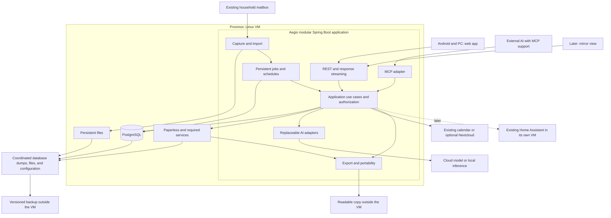

# Aegis household workspace roadmap

Updated: 2026-09-13. Status: product and architecture plan; application implementation has not started. VM tooling and GitHub baseline are available; see [VM access](docs/VM-ACCESS.md).

Repository rules live in [AGENT.md](AGENT.md). The owner's DDD/hexagonal architecture, Maven multimodule, maintainability, and English/localization requirements are detailed in [FOUNDATIONS.md](docs/architecture/FOUNDATIONS.md) and apply to every phase.

## 1. Goal and constraints

Aegis helps a couple capture records, find reliable answers, and coordinate everyday responsibilities. It can grow into a personal assistant with voice, proactive suggestions, a mirror display, and home integration.

Success means both people use it without technical assistance. The number of automated workflows is not a success metric.

Known requirements:

- Two users with Android phones and Samsung Calendar.
- An existing dedicated email account for contracts and household matters.
- Proxmox with a dedicated Aegis VM now provisioned.
- Java/Spring, DDD and hexagonal architecture, enforced through Maven modules.
- English repository content; German and English product-owned user-facing text.
- Small, focused classes and meaningful test coverage; larger coordinating facades are acceptable when cohesive.
- Cloud AI is acceptable; providers and eventual local inference remain replaceable.
- Documents and essential data remain accessible in open formats.
- Phone, PC, later MCP clients and a smart mirror use the same data.

Still to establish: mail provider, accounts behind Samsung Calendar, host capacity, backup destination, access beyond the current LAN, and notification delivery. Resolve each before its integration without blocking unrelated work.

## 2. Independent review conclusions

Three reviewers examined daily usability, Java architecture, and data/operations, then discussed overlapping concerns. This roadmap records the consolidated decisions and subsequent owner requirements.

| Earlier idea | Consolidated decision | Reason |
|---|---|---|
| Install Nextcloud immediately | Identify and integrate the existing calendar first | Avoid unnecessary migration, duplicates, and maintenance |
| Separate API, worker, and MCP services | Start with one modular Spring process | Lower operational burden; split later on evidence |
| Build a custom scheduler | Use a small persistent scheduling library | Avoid writing lease, heartbeat, and recovery machinery |
| Start a large agent session for every file | Store durably, process, then invoke AI as needed | Capture remains available during AI failure |
| Markdown as primary memory | Markdown preferences, structured facts in PostgreSQL | Preserve provenance, validity, permissions, and conflicts |
| CSV provides full independence | Distinguish readability, migration, and continued operation | A CSV is not a replacement task application |
| Intelligent daily planning first | Deterministic Today view and clear ownership | AI must not invent or hide deadlines |
| Build everything together | Complete a small workflow and run a two-week pilot | Expansion depends on use by both people |

Accepted design tradeoff: Aegis owns simple tasks and provides open exports. During an Aegis outage, tasks remain readable and migratable but lack full collaborative editing. If independent active task management becomes mandatory, choose an established task system as the source of truth before phase 3.

## 3. Target architecture



This is an operational view. Compile-time dependencies follow FOUNDATIONS.md: infrastructure adapters depend inward on application/domain contracts.

### Technology choices

| Area | Direction |
|---|---|
| Backend | Java 21 and compatible stable Spring Boot; pin dependencies during scaffolding |
| Architecture | DDD, hexagonal boundaries, Maven multimodule modular monolith |
| API | Spring MVC and REST; SSE for visible chat progress |
| Security | Spring Security, two users, application-level authorization |
| Persistence | PostgreSQL, Spring Data JPA in adapters, separate domain models, Flyway |
| Jobs | db-scheduler in PostgreSQL plus business operation records |
| AI | Spring AI behind narrow application-owned interfaces |
| MCP | Spring AI MCP Server, Streamable HTTP; read-only tools first |
| Frontend | React, TypeScript, Vite, Tailwind, shadcn/ui; installable PWA |
| Localization | German/English catalogs; stable English machine contracts |
| API contract | OpenAPI and generated TypeScript client |
| Documents | Paperless API and required Redis/conversion services |
| Calendar | CalendarPort; select integration after account discovery |
| Operations | Debian VM, Docker Compose, pinned versions, Caddy when HTTPS is introduced |
| Recovery | Restic for consistent recovery artifacts; separate readable exports |
| Verification | Plain-Java domain tests, architecture checks, PostgreSQL/Testcontainers, selected Playwright flows and real Android checks |

Spring Modulith may help verify boundaries; do not add a second persistent event mechanism without need. Kafka, Kubernetes, a separate vector database, and microservices are outside initial scope.

### Business capabilities

```text
identity       Users, household membership, authorization
inbox          Uploads, mail accounts, receipt and import state
documents      Paperless references, search and source access
contracts      Contract identity, facts, provenance and validity
planning       Tasks, deadlines, Today view, calendar port
assistant      Conversations, provider adapters, runs and proposals
notifications  Delivery attempts, preferences, deduplication
operations     Processing state, scheduling and execution limits
portability    Exports, checksums, imports and recovery support
```

REST, MCP, jobs, and agents invoke the same use cases. MCP does not duplicate business rules. Refine context boundaries around real use cases rather than generating empty modules for every candidate capability.

## 4. Data ownership and portability

| Data | Source of truth | Independent access or format |
|---|---|---|
| Original and archive rendition | Paperless files | Original format, PDF/A where generated, Paperless export |
| Original email | Provider mailbox and unchanged local copy | EML with attachment relationships in a manifest |
| Document title/classification | Paperless | Export metadata; Aegis keeps references and processing state |
| Contract facts and confirmed deadlines | Aegis PostgreSQL | Versioned JSON plus CSV/Markdown |
| Tasks, ownership and completion | Aegis PostgreSQL | JSON for migration, CSV/Markdown for reading |
| Calendar events | Selected provider | ICS; Aegis retains external identity and sync state |
| Household preferences | Versioned Markdown | Markdown without secrets |
| Executable planning rules | Aegis PostgreSQL | JSON, with optional documented descriptions |
| Chat and action history | Aegis PostgreSQL | Markdown/JSON; important decisions become explicit facts |
| Indexes, embeddings, summaries | Rebuildable derived data | Never the only copy of a fact |

### Minimum model

- DocumentRef: stable internal ID, Paperless ID, checksum, origin, permissions, import state.
- SourceRef: document/mail ID, reliable page or text location, optional excerpt. Never invent a page reference.
- Contract/Fact: field, value, unit/currency, known validity, source, review state, prior version, observation and confirmation metadata.
- Task: title, one owner or explicitly unassigned, status, actual due date, separate planned work date, source, version.
- CalendarLink: provider, calendar/event IDs, version/ETag where supported, last successful sync.
- Operation: type, idempotency key, references, state, attempts, failure category, timestamps and budget.
- Delivery: recipient, task/event version, attempts and confirmed delivery state. Distinguish stored, sent, delivered and read only when supported by evidence.
- Proposal: specific proposed change, target version, source, review and approval state.
- ExportManifest: schema version, creation time, IDs, relative paths, checksums and completeness.

Facts distinguish extracted, confirmed, rejected, and superseded states. New AI processing must not silently overwrite confirmed values. Amendments can introduce a new validity period.

External Paperless IDs may change during migration. Reimport matches stable Aegis IDs/checksums, reports missing originals, and restores relationships instead of blindly reusing external IDs.

### Three distinct promises

1. **Readable:** PDF, EML, Markdown and CSV open without Aegis.
2. **Migratable:** Versioned JSON/ICS preserve relationships and are tested against a fresh installation or suitable external software. Foreign applications may not support every field.
3. **Operational:** Paperless and calendar remain directly usable while running. Full task management and chat require Aegis.

Exports initially flow one way. Editing a CSV does not update working data. Later import provides an explicit preview and conflict checks.

### Proposed VM storage

```text
/srv/aegis/
  deploy/                   Compose and operational configuration
  source/                   Application working copy
  data/
    postgres/               Database files; never edit manually
    paperless/              Originals, archive renditions and service data
    ingress/                Accepted uploads awaiting archival
    emails/                 Unchanged EML files
    knowledge/              Household Markdown knowledge
  exports/
    generations/            Complete, atomically published generations
    latest/                 Last successful generation
  backup-staging/           Consistent dumps and manifests
```

Readable filenames contain date, title and ID. Relative source links work within exports. Proposals retain their unconfirmed status. An incomplete export never replaces a known-good generation.

## 5. Reliable workflows

### Upload

1. Receive and durably store the file in ingress.
2. Record checksum and receipt; only then acknowledge successful storage.
3. Schedule processing durably. Filesystem and database do not share a transaction: reconcile orphan files and incomplete records.
4. Submit to Paperless and verify actual completion.
5. Store the reference, then schedule extraction when enabled.
6. Mark processing complete only after success. Remove staging copies after verified archival and the retention rule.

Localized states cover uploading, saved, processing, ready, needs review, and failed/retrying. Interrupted/offline uploads never show false success. Do not promise offline writes until conflict and retry behavior are tested.

### Email

One Aegis adapter owns the mailbox pipeline, saves EML, handles attachments/body text, and submits documents to Paperless. Do not enable Paperless's mail consumer for the same account simultaneously. Text-only mail and complete provenance justify this integration.

- Connect through provider-appropriate OAuth or IMAP/app passwords. Registration or reauthentication may be necessary.
- Keep credentials server-side, outside prompts and readable exports.
- Start with a small historical window, then new mail.
- Use a separate archive-building mode for history: no flood of current tasks from obsolete deadlines; group suggestions for review.
- Track account, folder, UIDVALIDITY/UID for IMAP and content checks. Message-ID alone is insufficient.
- Advance progress only after durable capture; retries are safe.
- Preserve provider messages. Processed mail does not mean completed work.
- Archive a repeated attachment once while preserving all origins. Different checksums with similar content generate duplicate hints rather than automatic deletion. Signature images do not create tasks.
- Handle text-only mail, multiple attachments, forwards, encrypted PDFs, invalid files, expired tokens and moved messages visibly.
- Portal links create retrieval tasks if no connector exists; linked invoices are not yet archived.

### Jobs and external actions

db-scheduler coordinates durable schedules; operation records own business state, idempotency and audit. Phase 1 proves atomic business-state/job creation. Use a small outbox only if a shared transaction is unavailable.

Payloads carry stable IDs/schema versions, not serialized Java object graphs. Old jobs remain readable across updates or are explicitly migrated.

Assume at-least-once execution. External writes use stable action identity. After timeouts, reconcile before retrying. Use bounded backoff and visible persistent failures. Do not hold database transactions open across external model calls or user approvals.

### Daily planning and notifications

- A deterministic core combines confirmed appointments, overdue tasks, deadlines and lead times.
- Use Europe/Berlin explicitly; distinguish dates, all-day events, instants and recurring local schedules.
- Account for daylight saving, recurrence, rescheduling and cancellation.
- AI may phrase summaries and propose priorities; it does not guess authoritative deadlines.
- Postponing work does not move the real deadline.
- One responsible person or explicitly unassigned; shared visibility is not shared responsibility.
- One agreed daily overview plus relevant changes; deduplicate repeated notifications.
- Catch up once after downtime. Discard stale reminders against current versions rather than sending obsolete summaries in bulk.
- Existing calendar reminders cover existing events during read-only integration. New task reminders need a separately tested channel. Until available, Today is an on-demand view, not a promised push service.
- Test actual Samsung power-saving and notification behavior.
- Show stale data and last successful sync. Failed fetches must not appear as an empty day.
- Sending/delivery have independent states; a saved task does not prove delivery. Test deliberate delivery failures.

### Chat, AI and authorization

- Bounded structured extraction for simple cases; bounded multistep runs for research.
- Application-owned extraction/research interfaces keep vendor types out of business code.
- Add a Claude Agent SDK service only for a demonstrated need.
- Stream answers, deliberate progress, sources and results, not hidden model reasoning.
- Persist visible run state; reconnecting retrieves it instead of repeating writes. Exact token replay is unnecessary.
- Provider switching preserves data/jobs; evaluate quality and tool behavior separately.
- Treat document/email instructions as data, never as permission grants.
- Check access before search and again before reads/actions, including caches/exports.
- Direct Paperless access preserves personal/shared boundaries through individual permissions or a shared-only scope. Broad tokens/common exports must not expose private records. Administrative access is distinct from normal user rights.

## 6. Delivery phases and acceptance gates

Phases are dependency-driven, not fixed delivery-date promises. Each ends in a demonstrated capability. Provider-specific spikes are explicit work rather than assumed one-click integration.

### Phase 0 — Inventory and decisions

**Outcome:** Match real devices, accounts and habits.

Work:

- Identify mail authentication, mailbox volume, calendar accounts/sharing and local-only calendars.
- Verify host resources, storage, backup target and access requirements.
- Select ten scenarios with both users and 20–30 representative records: scan, invoice, contract, amendment, text email, portal notice and difficult scan.
- Agree shared/private areas, notifications and initial locale preference.
- Pin compatible stable dependencies and check provider authentication/license requirements before integration.
- Record the accepted Maven/DDD/hexagonal foundation and decisions about jobs, ownership and recovery.

**Acceptance:** Both users recognize their workflows; mail/calendar have concrete routes. No unrequested calendar migration. Approved requirements and implementation recommendations are distinguished.

### Phase 1 — Operations, data foundation and recovery

**Outcome:** Durable data and a tested recovery path before reliance.

Work:

- Create Maven modules, React foundation, PostgreSQL and Flyway.
- Enforce domain/application/adapter boundaries with architecture tests; keep JPA out of domain models.
- Configure two accounts with Spring Security; open registration is unnecessary.
- Configure Compose, intended network access, persistent volumes and Paperless.
- Test interrupted jobs, retries, atomic publication and visible failures.
- Establish backup/export state and separately accessible recovery instructions.
- Add health checks, capacity visibility and useful logs without content/tokens.
- Add CI with runnable builds; normal checks need neither private VM connectivity nor live AI credentials.

**Acceptance:** Container recreation preserves data. Both users log in. Unauthorized access fails, including direct Paperless personal-document access or an explicitly shared-only access arrangement. A job survives interruption. A fresh environment restores a backup and opens an original. Architecture checks detect forbidden dependencies.

### Phase 2 — Capture and retrieval without AI

**Outcome:** Both people upload and find documents easily.

Work:

- Phone file/scan upload and desktop drag-and-drop with clear status and safe retry.
- Paperless preview and full-text/metadata search.
- One inbox without mandatory sorting; exceptions receive attention.
- Readable export, manifest, checksums, relative links and external copy.
- Real-device Android sharing spike; keep reliable upload as fallback. Native wrapper only on demonstrated need.
- Both locale catalogs from the first product screen.

**Acceptance:** Both users independently upload scan/PDF samples. Interrupted uploads never report false success. Retries do not duplicate documents. Exported samples open elsewhere with Aegis/Paperless stopped. Core screens work in German and English.

### Phase 3 — Tasks and shared Today view

**Outcome:** Help complete responsibilities before intelligent narration.

Work:

- Create, assign, complete and reschedule tasks, preserving separate deadlines and sources.
- Read the chosen calendar through CalendarPort.
- Combine appointments, tasks, unassigned work and review items.
- Define preferences/deduplication and test an actual delivery channel. Until then, Today is on-demand.
- Export tasks to versioned JSON plus CSV/Markdown; test import into a fresh installation.

**Acceptance:** Changes appear on both devices without silent conflict loss. Rescheduling preserves deadlines. Failed calendar access is visible. Tasks, owners and source links survive reimport even when Paperless IDs change. Automatic reminders require successful tests on both phones.

### Phase 4 — Household mailbox and AI proposals

**Outcome:** New documents and text mail produce explainable review items.

Work:

- One provider, bounded test history, EML preservation and origin tracking.
- One cloud model through the extraction port.
- Extract counterparties, amounts, possible deadlines and action candidates with sources.
- Let users confirm, correct or reject proposals.
- Confirmed calendar writes with external IDs/retry protection.
- Cost, time and attempt limits per operation.

**Acceptance:** Repeated polling does not duplicate tasks. Text-only mail works. Portal links do not masquerade as invoices. Token/PDF failures are visible. AI outage does not block capture. Unconfirmed deadlines remain unconfirmed. Historical import does not flood notifications.

### Phase 5 — Two-week household pilot

**Outcome:** Demonstrate reduced work for both people.

Use new material and key existing records, not complete historical migration. Add no major features during the pilot.

| Measurement | Provisional target |
|---|---|
| Store an existing file | At least 8/10 within 30 seconds to confirmed storage; distinguish network time |
| Find a known document | At least 8/10 within one minute |
| Independent use | Both complete core flows without developer help |
| Lost acknowledged uploads | Zero in checked cases |
| Duplicate tasks/events from retries | Zero in checked cases |
| False saved/completed claims | Zero in checked cases |
| Inbox maintenance | Aim for approximately ten minutes weekly; record actual volume |
| Notifications | Useful or explicitly recorded as unnecessary; delivery is not assumed |

These samples are acceptance targets, not statistical guarantees. Record confusing behavior, excess steps, missing information and technical failures. Ask both users what helps and what frustrates them.

**Acceptance:** Both want to continue. Fix reliability/usability issues before expansion. If the pilot fails, simplify capture and coordination before adding chat, voice or mirror features.

### Phase 6 — Source-based assistant and MCP

**Outcome:** Natural-language questions return grounded answers.

Work:

- Streaming chat with source links and reconnectable runs.
- Tools for search, source access, contract state and upcoming work.
- Authenticated MCP, read-only first.
- Fixed real questions with expected sources, including contradictions and amendments.
- Evaluate a second adapter; local inference remains optional and hardware-dependent.

**Acceptance:** Answers link actual sources and reveal gaps. MCP respects permissions. Provider changes require no data migration. Reference cases distinguish original terms and newer invoices.

### Phase 7 — Proactive assistance and bounded actions

**Outcome:** Detect changes and prepare useful steps.

Work:

- Price changes, approaching confirmed deadlines and preparation suggestions.
- Explicitly allowed recurring workflows.
- Previews, scoped authorization and action history.
- MCP writes through the same authorization layer.
- Bind approval to action/data version and invalidate stale approvals.

**Acceptance:** External messages, spending and contract actions have appropriate authorization. Retries do not duplicate writes. Stale proposals are rechecked. Notifications are grouped and prioritized.

### Phase 8 — Mirror and voice

**Outcome:** Access the same assistant in additional places.

Work:

- Read-only mirror route with last-update/offline state and limited device identity.
- Push-to-talk first with replaceable speech recognition/synthesis.
- Personal/sensitive confirmations on authenticated phones.
- Wake words and room microphones only after a successful voice pilot.

**Acceptance:** No continuous AI calls for display. Speech errors can be corrected. Room devices do not inherit personal access. Voice failure does not affect capture/planning.

### Phase 9 — Home integration and broader assistance

**Outcome:** Connect home context without making basics dependent on AI.

Work:

- Integrate the existing separate Home Assistant only under a specific integration request; do not recreate it for this roadmap.
- Read selected states, then permit a small explicit action set.
- Debounce events and restrict capabilities per device.
- Handle security-sensitive actions individually; voice identity alone is insufficient.

**Acceptance:** Home automation works without AI. Its outages do not impair documents. Actions are traceable and limited to allowed capabilities.

## 7. Operations and recovery

### Minimal runtime

One Linux VM runs Aegis, PostgreSQL, Paperless and required services, plus HTTPS termination when introduced. Separate databases/users per service; a compatible shared PostgreSQL instance is possible. Start with the provisioned 4 vCPU/8 GiB and measure. Guest free memory does not establish host spare capacity.

Nextcloud remains optional. Local inference needs separate RAM/VRAM, storage, model-size and latency assessment. Experimental model operations must not destabilize core services.

### Recovery objectives

- Proposed RPO: at most 24 hours loss after total server failure, backed by daily successful external backups. Increase frequency if unacceptable.
- Proposed recovery target: within one day after replacement hardware/storage is available; measure in a restore exercise.
- Refresh exports after changes where feasible and at least daily; display last success. Only external copies survive complete server loss.
- Second local device plus encrypted offsite backup with retained generations. Deletion must not immediately remove every recovery copy.
- Do not treat copying live PostgreSQL files as a consistent backup. Coordinate supported dumps, Paperless exports, files and configuration.
- Recovery instructions and key access cannot exist only inside Aegis.

### Visibility and maintenance

Show last successful mail/calendar access, failed operations, latest export/external backup and disk capacity. Notify relevant failures rather than every successful poll.

Agree maintenance intervals in phase 1: regular inspection, grouped updates with backup and core checks, periodic restore tests and additional tests after significant backup/data changes. Proxmox snapshots supplement but do not replace external recovery copies.

## 8. Evidence required for additional infrastructure

| Addition | Trigger |
|---|---|
| Separate worker | Measurable API interference or independent restart/resource needs |
| Claude Agent SDK service | Demonstrated material benefit for a concrete workflow |
| pgvector | Real queries fail despite adequate full-text search/metadata |
| Local inference | Offline/privacy preference or measured economics justify maintenance |
| Native Android wrapper | Sharing/upload/notifications remain inadequate on real devices |
| Nextcloud | Existing integration is unsuitable or self-hosting deliberately chosen |
| Extra VM/service | Distinct hardware or failure-isolation needs |

## 9. Main risks and checks

| Risk | Mitigation |
|---|---|
| Only the developer uses it | Both test independently |
| Inbox creates administration | No mandatory sorting; measure maintenance |
| AI invents facts | Provenance, review state, temporal versions |
| Duplicate actions | Idempotency, external IDs, reconciliation |
| Outage confused with loss | Separate readability, migration and recovery |
| MCP/mirror bypass permissions | Shared authorization and scoped identity |
| Sync spreads mistakes | One owner per data type, versions/conflicts |
| Agent loops cost too much | Budgets, visible stops, no silent fallback |
| Mail archive creates task noise | Separate capture from action detection |
| Features outpace reliability | Gates and two-week pilot |
| Architecture becomes ceremony | Real use cases, enforced boundaries, no empty modules |
| Localization becomes late rework | Two catalogs from the first screen; English machine contracts |

## 10. Next concrete work

1. Identify mail/calendar accounts, host capacity and backup destination.
2. Select ten real scenarios and representative records.
3. Record ADRs for build boundaries, calendar ownership, jobs, mail capture and recovery.
4. Implement phase 1 and pass its recovery/architecture checks.
5. Demonstrate phone PDF upload, confirmed storage, retrieval and opening an export without the app.

Planned services are not implemented services. Verified tooling is recorded in VM-ACCESS.md.

## 11. Primary technical references

These sources establish building blocks. Their combination, targets and delivery order are Aegis decisions.

- [Spring AI API](https://docs.spring.io/spring-ai/reference/api/index.html)
- [Spring AI tool calling](https://docs.spring.io/spring-ai/reference/api/tools.html)
- [Spring AI MCP](https://docs.spring.io/spring-ai/reference/api/mcp/mcp-overview.html)
- [db-scheduler](https://github.com/kagkarlsson/db-scheduler)
- [Spring Modulith events](https://docs.spring.io/spring-modulith/reference/events.html)
- [Paperless administration and export/import](https://docs.paperless-ngx.com/administration/)
- [Paperless usage and email](https://docs.paperless-ngx.com/usage/)
- [Paperless API](https://docs.paperless-ngx.com/api/)
- [DAVx5 Android synchronization](https://manual.davx5.com/introduction.html)
- [Home Assistant WebSocket API](https://developers.home-assistant.io/docs/api/websocket/)
