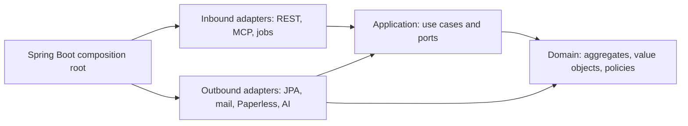

# Architecture foundations

Status: owner-approved foundations, implemented by the first runnable test, plus explicitly marked future defaults and open product decisions. See the execution status and independent review for verified implementation evidence.

## Accepted requirements

1. Java/Spring is the backend platform.
2. Use Domain-Driven Design and hexagonal architecture.
3. Keep the repository in English; product-owned presentation supports German and English.
4. Preserve household data independently of AI providers and disposable application containers.
5. REST, MCP, and agents use the same authorization and application use cases.
6. Daily planning and document capture work without AI.
7. Use Maven modules separating domain, application, and adapters.
8. Maintainability and small, cohesive classes take priority; larger facades are acceptable when coherent.
9. Maintain meaningful test coverage without unnecessary tests. Records are welcome where appropriate.
10. Use a reviewable Git workflow; mapping choices are delegated to the implementer.

The working architecture remains a modular monolith. Runtime distribution is independent of domain boundaries and requires a demonstrated operational need.

## Dependency direction



Arrows show compile-time dependencies. Runtime calls can go from an application service through an output port to an adapter while preserving this dependency direction.

Domain invariants belong in aggregates and value objects. Application services coordinate authorization, loading, domain behavior, persistence, and durable work. Adapters translate protocols and storage representations; they do not decide business rules.

Example: postponing a task calls a planning use case. The task changes its planned work date while preserving its real deadline. Neither the REST controller nor the calendar adapter implements that invariant.

## Accepted build layout

Maven modules enforce the most important dependency boundaries, while packages and ArchUnit enforce bounded-context boundaries. Create modules as capabilities are implemented; do not generate dozens of empty projects.

```text
backend/
  pom.xml
  planning/
    domain/
    application/
    adapters/
  documents/                  Added when its first use case is implemented
  bootstrap/                  Executable Spring Boot application and wiring
frontend/                     React/TypeScript PWA
```

Within a context, adapters may initially share one module with separate inbound/outbound packages. Split them only when dependency isolation or testing warrants it. A public context contract must not expose internal aggregates or persistence entities to other contexts.

The owner selected separate Maven modules over a single-module package-only arrangement. Keep that decision unless explicitly revisited.

## Persistence and transactions

Use separate JPA persistence models and explicit mappers. Domain repository contracts describe aggregate operations rather than generic Spring Data CRUD. Read-only projections can use dedicated query ports without reconstructing aggregates when no business mutation occurs.

Place Spring transaction handling in decorators/configuration around application use cases. Persist business changes and job publication atomically where supported. Do not hold a database transaction open while waiting for a cloud model, mail provider, or user approval.

Use optimistic concurrency and explicit conflict responses. Inject `Clock` for time-sensitive logic. Store money with decimal precision and an explicit currency. Validate actual business constraints rather than imposing arbitrary aggregate complexity.

## Provisional context map

| Context/capability | Owns | Integration boundary |
|---|---|---|
| Identity | Membership and access policy | Authentication adapter |
| Inbox | Receipt and import state | Upload and mail |
| Documents | Archive references and source access | Paperless |
| Contracts | Contract facts and validity/review state | Documents application contract |
| Planning | Tasks, deadlines, planned work | Calendar port |
| Assistant | Conversations, proposals, bounded execution | Model and tool ports |
| Notifications | Delivery attempts and preferences | Delivery provider |
| Operations/portability | Job status and export/import coordination | Scheduler and storage |

These are candidate boundaries, not a mandate for eight aggregates or eight services. Refine names and boundaries around the first real workflows and capture changes in ADRs.

## Localization contract

- English is the internal language and translation-key language.
- Product locale catalogs cover `de` and `en`; proposed initial default is German with a per-user preference.
- API responses use stable codes and parameters. UI and notification adapters render localized messages.
- Preserve free text and source language. AI-generated prose follows the requested user's locale where appropriate, while source citations remain faithful to originals.
- Test pluralization, missing translations, parameter parity, dates/currencies, accessibility labels, and fallback behavior. A locale switch must not change stored enum values or deadlines.
- Start with English technical documentation only; do not maintain parallel German developer docs.

## Engineering decisions and defaults

| Topic | Recommendation | Status |
|---|---|---|
| Build boundaries | Maven modules plus ArchUnit | Module split approved; ArchUnit is implementation choice |
| Domain tests | JUnit, fast plain-Java tests; regression tests for defects | Meaningful coverage approved; no arbitrary coverage target |
| Development style | Test-first when it helps invariants/bug fixes; no mandatory TDD ceremony | Implementation default |
| Java style | Records for suitable immutable data; small cohesive classes; larger coherent facades allowed | Approved |
| Lombok | Avoid initially, especially in domain/application | Reversible implementation default |
| Mapping | Explicit small mappers; MapStruct only when repetition warrants it | Choice delegated by owner |
| API | REST with explicit DTOs, stable error codes, OpenAPI-generated frontend client | Implementation default |
| Git | Short feature branches and reviewable commits; published history preserved | Workflow accepted; initial baseline updates may be direct |
| CI | Backend verification, architecture checks, frontend build/tests and locale checks | Implementation default supporting meaningful tests |
| Scope | First complete vertical slice: capture, persist, retrieve, export | Roadmap direction |

Do not equate an implementation default with a specific owner preference. These defaults can be refined without changing accepted architectural boundaries; explain consequential changes and record them in ADRs.

## Additional maintainability defaults

- Use explicit business operations rather than generic setters to preserve aggregate invariants.
- Use injected clocks and identifiers where nondeterminism affects tests. Represent instants with Instant, date-only deadlines with LocalDate, and recurring local schedules with an explicit ZoneId. Do not substitute a timestamp for every date.
- Represent money with BigDecimal and a currency; rounding is an explicit business decision. Do not use floating point for amounts.
- Expose stable machine-readable API error codes and correlation IDs with localized presentation. Never send raw stack traces to users. Standard HTTP problem details are a suitable boundary representation.
- Use explicit DTOs and version-sensitive updates for shared changes. Avoid framework types in public contracts and uncontrolled entity serialization.
- Evolve schemas through reviewed Flyway migrations. Once a migration has been shared/applied, add a new migration rather than editing its history. Prefer additive changes and document any data conversion or rollback limitation.
- Keep dependency updates deliberate and compatible. Use a BOM and wrappers rather than unrelated floating versions.
- Add minimal health, readiness and operation visibility. Preserve useful diagnostics without logging household document content or tokens.
- Use coverage reports to find gaps, especially branches and failure behavior. Domain invariants, permissions, retry behavior and data restoration matter more than trivial accessor coverage.

## Household sharing and initial delivery decisions

The owner wants one shared information space. Both authenticated members can read household documents, facts and tasks, including records associated with the other person. A record may concern one person, both people, a house, or several subjects. Subject associations are searchable metadata, never inferred access restrictions. Keep uploader, subject and task owner as distinct concepts. Individual accounts remain useful for preferences, responsibilities, audit, and action approval.

Do not add private document areas to the first release. Continue enforcing household membership and limited mirror/MCP identities. Authentication secrets and provider tokens are technical credentials, not searchable shared knowledge. The direct Paperless path must expose the same shared collection to both members.

Start with a durable in-app notification inbox. Add Android Web Push after HTTPS and actual-device tests. Model delivery through a port so a Telegram adapter can be added later without duplicating tasks or business rules. Telegram is not selected or required now. A notification opens the corresponding record in Aegis; delivery and task completion remain separate.

Prepare calendar capabilities behind ports, including future writes, without implementing or granting unrestricted calendar mutations yet. Calendar reading can support the pilot; creation, rescheduling and deletion are deferred until the basic workflow proves useful and provider behavior is tested.

## Initial backup target and remaining checks

An external 1 TB disk is available and is a reasonable candidate for the first local backup of the currently 100 GiB VM. Actual suitability depends on free space, health, existing contents, filesystem, backup scope and retention. Do not equate nominal capacity with guaranteed retention.

Proposed first stage: consistent application backups with Restic to the external disk, with visible completion time and a tested restore. Offsite backup is a later improvement; one nearby disk does not protect against losing both devices together. If disconnected, automatic backups cannot run, and Aegis must show the stale backup state.

Before configuring the disk, establish where it will be connected, what it already contains, and how it is safely exposed to the VM. Do not format, repartition, or change Proxmox storage based solely on its availability. Keep encryption/recovery credentials accessible outside the failed system. A 24-hour recovery point remains a proposal until the actual schedule and availability are agreed.

## Shared agent entry points

`AGENT.md` is canonical. `AGENTS.md` directs Codex to read it; `CLAUDE.md` imports it. Use the conventional case-sensitive filenames so they also work on Linux. These files align instructions; simultaneous editing still needs separate worktrees or explicit coordination.

References: [Codex repository instructions](https://developers.openai.com/codex/guides/agents-md), [Claude project memory and imports](https://code.claude.com/docs/en/memory).
