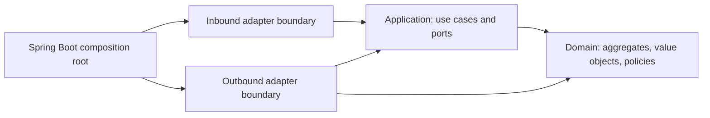

# Architecture foundations

Owner-approved engineering rules and architectural boundaries. See [README.md](../../README.md) for implemented capabilities and [GitHub Issues](https://github.com/CedricSchmitter/Aegis/issues) for proposed integrations. An architectural boundary does not imply that an adapter is already implemented.

## Accepted requirements

1. Java/Spring is the backend platform.
2. Use Domain-Driven Design and hexagonal architecture.
3. Keep the repository in English; product-owned presentation supports German and English.
4. Preserve household data independently of AI providers and disposable application containers.
5. REST, MCP, and agents use the same authorization and application use cases.
6. Daily planning and document capture work without AI.
7. Use Maven modules separating domain, application, and adapters.
8. Maintainability and small, cohesive classes take priority; larger facades are acceptable when coherent.
9. Maintain meaningful test coverage without unnecessary tests. Records are welcome where appropriate.
10. Use a reviewable Git workflow; mapping choices are delegated to the implementer.

The working architecture remains a modular monolith. Runtime distribution is independent of domain boundaries and requires a demonstrated operational need.

## Dependency direction



Arrows show compile-time dependencies. Runtime calls can go from an application service through an output port to an adapter while preserving this dependency direction.

Domain invariants belong in aggregates and value objects. Application services coordinate authorization, loading, domain behavior, persistence, and durable work. Adapters translate protocols and storage representations; they do not decide business rules.

Example: postponing a task calls a planning use case. The task changes its planned work date while preserving its real deadline. Neither the REST controller nor the calendar adapter implements that invariant.

## Accepted build layout

Maven modules enforce the most important dependency boundaries, while packages and ArchUnit enforce bounded-context boundaries. Create modules as capabilities are implemented; do not generate dozens of empty projects.

```text
backend/
  pom.xml
  planning/
    domain/
    application/
    adapters/
  documents/                  Document domain, application and adapters
  contracts/                  Contract facts, provenance, review state and deadline calculation
  review/                     Central workflow references; producer contexts keep business authority
  bootstrap/                  Executable Spring Boot application and wiring
frontend/                     React/TypeScript web app
```

Within a context, adapters may initially share one module with separate inbound/outbound packages. Split them only when dependency isolation or testing warrants it. A public context contract must not expose internal aggregates or persistence entities to other contexts.

The owner selected separate Maven modules over a single-module package-only arrangement. Keep that decision unless explicitly revisited.

## Persistence and transactions

Use separate JPA persistence models and explicit mappers. Domain repository contracts describe aggregate operations rather than generic Spring Data CRUD. Read-only projections can use dedicated query ports without reconstructing aggregates when no business mutation occurs.

Place Spring transaction handling in decorators/configuration around application use cases. Persist business changes and job publication atomically where supported. Do not hold a database transaction open while waiting for a cloud model, mail provider, or user approval.

Use optimistic concurrency and explicit conflict responses. Inject `Clock` for time-sensitive logic. Store money with decimal precision and an explicit currency. Validate actual business constraints rather than imposing arbitrary aggregate complexity.

## Capability boundaries

| Context/capability | Owns | Integration boundary |
|---|---|---|
| Identity | Membership and access policy | Authentication adapter |
| Inbox | Receipt and import state | Upload and mail |
| Documents | Archive references and source access | Paperless |
| Contracts | Contract facts and validity/review state | Documents application contract |
| Planning | Tasks, deadlines, planned work | Calendar port |
| Assistant | Conversations, proposals, bounded execution | Model and tool ports |
| Notifications | Delivery attempts and preferences | Delivery provider |
| Review | Cross-context workflow references and decisions | Producer application contracts |
| Operations/portability | Job status and export/import coordination | Scheduler and storage |

Identity, documents, contracts, planning, notifications, review, operations, portability and assistant exist as modules. Identity tells persons from the household's assistant account; the documents context learns the persons through its own port backed by the identity contract ([ADR-0017](adr/ADR-0017-persons-and-the-assistant-account.md)). The assistant module provides the bounded AI execution boundary of [ADR-0003](adr/ADR-0003-bounded-ai-execution.md) and document classification and folder placement ([ADR-0004](adr/ADR-0004-automatic-document-classification.md), [ADR-0005](adr/ADR-0005-automatic-folder-placement.md)); chat workflows remain issue-driven. Contracts owns observations and confirmed deadline calculation ([ADR-0007](adr/ADR-0007-contract-facts-and-provenance.md)); confirmed deadlines become planning tasks and reminders ([ADR-0008](adr/ADR-0008-contract-cancellation-tasks-and-reminders.md)). Review stores durable workflow references and delegates business actions to producer application contracts ([ADR-0009](adr/ADR-0009-central-review-inbox.md)). Operations reports integration status and the health of recurring jobs from the scheduler's persisted state ([ADR-0013](adr/ADR-0013-recurring-job-health.md)) and notifies the members once per incident when a job stops running ([ADR-0014](adr/ADR-0014-stale-job-notices.md)), the external backup fails or a disk runs low ([ADR-0015](adr/ADR-0015-backup-and-storage-health.md)). Add modules only for concrete use cases and capture substantial boundary changes in ADRs.

## Localization contract

- English is the internal language and translation-key language.
- Product locale catalogs cover `de` and `en`; the initial default is German with a per-user preference.
- API responses use stable codes and parameters. UI and notification adapters render localized messages.
- Preserve free text and source language. AI-generated prose follows the requested user's locale where appropriate, while source citations remain faithful to originals.
- Test pluralization, missing translations, parameter parity, dates/currencies, accessibility labels, and fallback behavior. A locale switch must not change stored enum values or deadlines.
- Start with English technical documentation only; do not maintain parallel German developer docs.

## Engineering decisions and defaults

| Topic | Recommendation | Status |
|---|---|---|
| Build boundaries | Maven modules plus ArchUnit | Module split approved; ArchUnit is implementation choice |
| Domain tests | JUnit, fast plain-Java tests; regression tests for defects | Meaningful coverage approved; no arbitrary coverage target |
| Development style | Test-first when it helps invariants/bug fixes; no mandatory TDD ceremony | Implementation default |
| Java style | Records for suitable immutable data; small cohesive classes; larger coherent facades allowed | Approved |
| Lombok | Avoid initially, especially in domain/application | Reversible implementation default |
| Mapping | Explicit small mappers; MapStruct only when repetition warrants it | Choice delegated by owner |
| API | REST with explicit DTOs, stable error codes, OpenAPI-generated frontend client | Implementation default |
| Git | Short feature branches and reviewable commits; published history preserved | Workflow accepted; initial baseline updates may be direct |
| CI | Backend verification, architecture checks, frontend build/tests and locale checks | Implementation default supporting meaningful tests |

Do not equate an implementation default with a specific owner preference. These defaults can be refined without changing accepted architectural boundaries; explain consequential changes and record them in ADRs.

## Additional maintainability defaults

- Use explicit business operations rather than generic setters to preserve aggregate invariants.
- Use injected clocks and identifiers where nondeterminism affects tests. Represent instants with Instant, date-only deadlines with LocalDate, and recurring local schedules with an explicit ZoneId. Do not substitute a timestamp for every date.
- Represent money with BigDecimal and a currency; rounding is an explicit business decision. Do not use floating point for amounts.
- Expose stable machine-readable API error codes and correlation IDs with localized presentation. Never send raw stack traces to users. Standard HTTP problem details are a suitable boundary representation.
- Use explicit DTOs and version-sensitive updates for shared changes. Avoid framework types in public contracts and uncontrolled entity serialization.
- Evolve schemas through reviewed Flyway migrations. Once a migration has been shared/applied, add a new migration rather than editing its history. Prefer additive changes and document any data conversion or rollback limitation.
- Keep dependency updates deliberate and compatible. Use a BOM and wrappers rather than unrelated floating versions.
- Add minimal health, readiness and operation visibility. Preserve useful diagnostics without logging household document content or tokens.
- Use coverage reports to find gaps, especially branches and failure behavior. Domain invariants, permissions, retry behavior and data restoration matter more than trivial accessor coverage.

## Household sharing and integration boundaries

The owner wants one shared information space. Both authenticated members can read household documents, facts and tasks, including records associated with the other person. A record may concern one person, both people (one subject each), the house, or several subjects; the household's assistant account is a member but never a subject ([ADR-0017](adr/ADR-0017-persons-and-the-assistant-account.md)). Subject associations are searchable metadata, never inferred access restrictions. Keep uploader, subject and task owner as distinct concepts. Individual accounts remain useful for preferences, responsibilities, audit, and action approval.

Do not infer private document areas from person associations. Continue enforcing household membership and limited mirror/MCP identities. A background job acts as the member who requested its work, or, when no member did, as a named household process that is never a member: it may call only the queries explicitly opened to household processes and no command ([ADR-0009](adr/ADR-0009-central-review-inbox.md)). Authentication secrets and provider tokens are technical credentials, not searchable shared knowledge. The direct Paperless path must expose the same shared collection to both members.

The in-app notification inbox is durable. Delivery adapters reuse notification identity and application
commands; notification delivery, read status and task completion are distinct states. The web app shows review cards
and notices in one inbox; a notice that announces a card is published but not listed a second time
([ADR-0009](adr/ADR-0009-central-review-inbox.md#combined-inbox-issue-83)). Calendar integration
uses the application-owned port; the selected external provider owns its events. AI/model adapters reuse
authorized application tools and cannot become a prerequisite for capture or deterministic planning. All AI work runs
through the one bounded execution boundary of ADR-0003: per-workload provider, model and budgets; tools granted per
workload and executed with the requesting member's authorization; results applied once through the owning context.

## Data ownership and portability

| Data | Source of truth | Portability rule |
|---|---|---|
| Original documents (PDFs and photos, [ADR-0011](adr/ADR-0011-photo-originals.md)), archive renditions and OCR full text | Paperless | Preserve original bytes, their media type, checksums and stable Aegis references; archive renditions are regenerated from the originals |
| Document title, folder tree, labels and their assignments | Aegis PostgreSQL ([ADR-0002](adr/ADR-0002-document-tree-and-labels.md)) | Stable folder/label IDs, aliases, provenance and review state in the versioned export; Paperless classification fields are not written. Folder names follow the [naming rules](adr/ADR-0002-document-tree-and-labels.md#folder-naming-rules); the built-in label vocabulary is seeded by migration while the starting tree is a tracked `ops/` seed ([ADR-0006](adr/ADR-0006-starting-folder-tree.md)) |
| Automatic analysis results, title origin and friendly filenames | Aegis PostgreSQL ([ADR-0004](adr/ADR-0004-automatic-document-classification.md)) | Generated values with run/model provenance, review decisions, filename override and history in the versioned export; originals keep their bytes and upload filename |
| Folder placement origin and pending placement proposals | Aegis PostgreSQL ([ADR-0005](adr/ADR-0005-automatic-folder-placement.md)) | Placement origin and the proposal a member has not decided on in the versioned export; folders are only created by a member accepting a proposal |
| Tasks and confirmed contract facts | Aegis PostgreSQL | Versioned structured export with source relationships and review state |
| Review workflow references and lifecycle | Aegis PostgreSQL ([ADR-0009](adr/ADR-0009-central-review-inbox.md)) | Stable card/source ids, lifecycle, versions and decisions in portable export schema 7; source facts stay in their owning context |
| Trash state of documents, tasks and contracts | Aegis PostgreSQL, on each record ([ADR-0010](adr/ADR-0010-recoverable-trash.md)) | Who, when and restorable-until in portable export schema 8; the record, its original and its links are never removed by trashing |
| Member kind (person or assistant account) | Aegis PostgreSQL, identity ([ADR-0017](adr/ADR-0017-persons-and-the-assistant-account.md)) | In portable export schema 9; which account is the assistant is set per installation, and an older export's subject "both" restores as one subject per person |
| Original email, when connected | Provider mailbox and unchanged local EML copy | Preserve attachment and message origins |
| Calendar events, when connected | Selected calendar provider | Retain external identity, version and synchronization state |
| Household prose/preferences | Versioned Markdown where appropriate; application preferences remain structured | Never include credentials |
| Executable rules, conversations and action history, when implemented | Aegis PostgreSQL | Preserve structured state and audit; significant conclusions become explicit facts |
| Whether the archive recognized text in a document | Aegis PostgreSQL, derived from the archive's OCR text ([ADR-0012](adr/ADR-0012-recognized-text.md)) | Not exported; measured again from the archive after a restore |
| Indexes, summaries and embeddings | Rebuildable derived data | Never the only copy of an authoritative fact |

Exports are one-way views, not another writable source of truth. Readability, migration and independent
operation are separate promises: an exported CSV does not provide collaborative task management.
Stable internal IDs and checksums preserve relationships when external Paperless IDs change.
Manual originals and confirmed facts must survive AI reprocessing. Facts need source, validity and review
state; conflicting or superseded sources remain distinguishable.

## Recovery boundary

The external Restic destination and isolated recovery are verified; see [BACKUP.md](../operations/BACKUP.md)
for actual scope, destination identity, schedule and evidence. Preserve consistent database/file captures,
visible failure/staleness and recovery keys outside the VM. A nearby external disk does not cover loss of
both host and disk. Recovery objectives, retention and offsite extensions are tracked in issues.

## Shared agent entry points

`AGENT.md` is canonical. `AGENTS.md` directs Codex to read it; `CLAUDE.md` imports it. Use the conventional case-sensitive filenames so they also work on Linux. These files align instructions; simultaneous editing still needs separate worktrees or explicit coordination.

References: [Codex repository instructions](https://developers.openai.com/codex/guides/agents-md), [Claude project memory and imports](https://code.claude.com/docs/en/memory).
